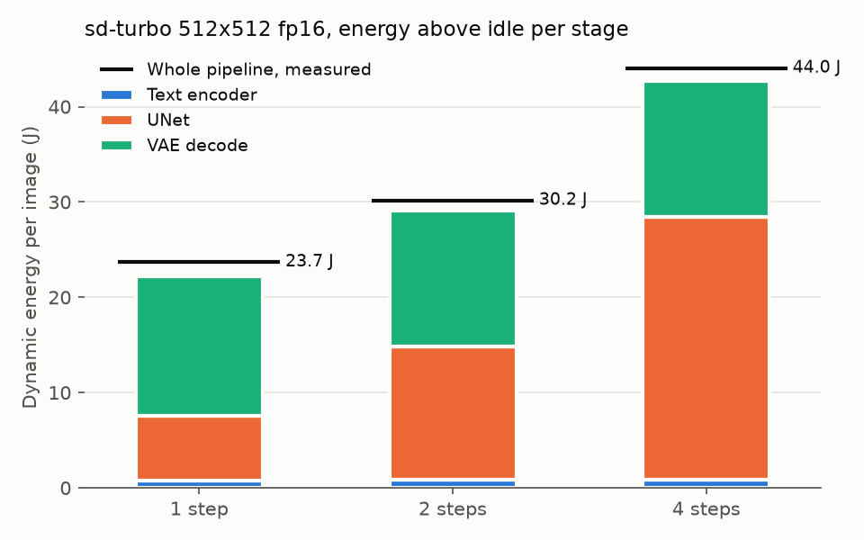

# gpu-sd-study

Latency and energy per image of a real-time image generation pipeline, split
by stage: sd-turbo at 512x512, fp16, batch 1, with 1, 2 and 4 denoising steps,
on one RTX 3080 Ti.



## Results

Median [IQR]. Latency is over 200 images, energy over 15 blocks of 3 s.
Dynamic energy is the energy above idle (108 W). The percentages are shares
of the dynamic energy of the whole pipeline.

| steps | ms/image | J/image total | J/image dynamic | mean W | text encoder | UNet | VAE decode | other |
|---|---|---|---|---|---|---|---|---|
| 1 | 111.9 [111.5-112.9] | 35.8 [35.2-36.3] | 23.7 [22.9-24.2] | 322 | 3% | 29% | 62% | 6% |
| 2 | 145.6 [145.1-147.6] | 45.6 [45.3-46.1] | 30.2 [29.8-30.7] | 321 | 3% | 46% | 48% | 3% |
| 4 | 211.1 [210.5-212.2] | 66.9 [65.2-67.5] | 44.0 [42.7-45.0] | 320 | 2% | 63% | 32% | 3% |

Per call: the text encoder takes 12.3 ms and 0.81 J, one UNet step 33 ms and
6.9 J, the VAE decode 61 ms and 14.6 J (dynamic energy). At 1 step the VAE
decode is more than half of both the time and the energy.

After the UNet, VAE and pipeline blocks the SM clock read between 1920 and
2025 MHz and the memory clock 9451 MHz. The power limit was 370 W, and NVML
reported a software power cap (clock reason 0x4) after every one of these
blocks. The GPU warmed from 41 to 60 °C over the 1-step blocks, then stayed
at 60-62 °C after the loaded blocks. `results/summary.md` has the full stability figures.

## Method

`measure.py` loads the pipeline, waits 15 s, then reads the energy counter
(`nvmlDeviceGetTotalEnergyConsumption`) at the start and end of 30 s of idle.
For each step count it runs 10 warmup images and 200 measured ones. CUDA
events around the text encoder, each UNet call and the VAE decode give the
time of each stage, and the wall clock gives the time of the image.

The energy counter cannot be read per image. It changes every 100 ms and
under-counts when read faster than about 2 Hz: by 14% at 10 Hz
([nvml-energy-probes](https://github.com/ethan-puyaubreau/nvml-energy-probes)).
An image takes 112 to 211 ms. So each stage is replayed alone, with the
inputs captured from a real image, in a loop of about 3 s (about 245 text
encoder calls, 90 UNet calls or 49 VAE decodes). The whole pipeline is run the same way
(14 to 27 images per block). The four kinds of block alternate, 15 rounds per
step count, and the counter is read once per block: the reading that ends one
block starts the next. Energy per call is the block energy divided by the
calls. Dynamic energy subtracts idle power times the block duration. Clocks,
temperature, power limit and clock reasons are read after each block and
after each image.

"Other" is the whole pipeline minus the three stages: the scheduler, kernel
launches and the gaps between kernels. It comes out at 3 to 6%, so the stages
measured alone add up to the pipeline.

`report.py` turns `results/` into the table and the figure.

## Limits

- The counter updates every 100 ms, so each end of a block may be up to
  100 ms late: a few percent per 3 s block, reduced by taking the median of 15
  blocks. In nvml-energy-probes the counter matched the NVML power reading
  within 5% when read once or twice a second; here it is read every 3 s.
  Neither has been checked against an external meter.
- NVML covers the board only: no CPU, RAM, or power supply losses. The
  pipeline also loads the CPU (launches, scheduler), which is not counted.
- Idle is a desktop session with the display on and the model in VRAM. The
  GPU did not drop to a low power state: at idle the SM clock read 1770 MHz
  and the memory clock 9451 MHz. Idle (108 W) therefore includes the display
  and the high memory clock. Dynamic energy is what the work adds on top of
  that state, not on top of a powered-off GPU.
- A stage replayed alone runs back to back, without the gaps it has inside
  the pipeline. The text encoder alone draws 172 W, the VAE decode 340 W.
- Clocks and temperature are sampled once per block, after the
  synchronization, so they show the state just after the work. The 1770 MHz
  and "idle" reason (0x1) after text encoder blocks are such a sample.
- Plain diffusers in eager mode: no `torch.compile`, CUDA graphs, TensorRT or
  smaller VAE. The text encoder runs for every image, although a real-time
  loop with a fixed prompt would cache it. Images stay on the GPU
  (`output_type="pt"`), so no copy to the CPU is timed.
- One GPU, one driver (610.88), Windows 11, one prompt, one run.

## Run

You need an NVIDIA GPU and a torch build with CUDA.

```
pip install -r requirements.txt
python measure.py     # about 12 min, downloads sd-turbo (about 2.5 GB) the first time
python report.py
```

`python measure.py --help` lists the options (step counts, number of images,
blocks and their duration).
